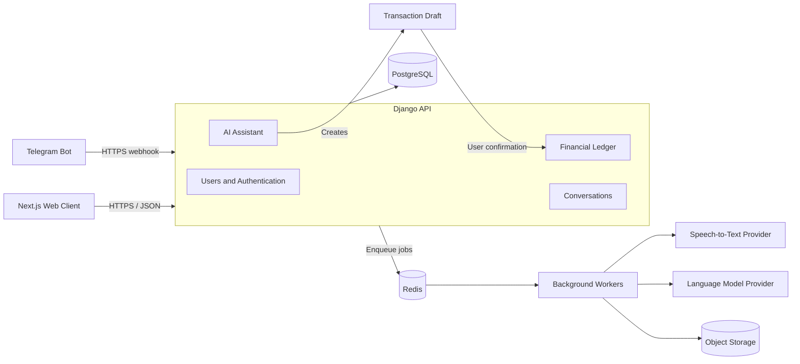

# Financify

Financify is a personal finance platform for recording income, expenses, and
transfers through a Telegram conversation and managing financial data through a
web application.

The repository is organized as a monorepo. The backend is a modular Django
application, the web client will use Next.js, and Telegram provides the
conversational interface for text and voice messages.

## Architecture



The API starts as a modular monolith. HTTP processes and background workers may
run independently while sharing the same Django codebase and PostgreSQL database.
Domain boundaries are kept explicit so a component can be extracted later when
independent scaling or operation is justified.

AI-generated data is always treated as untrusted input. Text and audio produce a
transaction draft, and only explicit user confirmation can create a financial
transaction.

## Current implementation

- Django REST Framework API under `apps/api`.
- PostgreSQL development service managed by Docker Compose.
- Custom UUID-based user model with email authentication.
- Case-insensitive email normalization and database constraint.
- Password validation using Django's configured validators.
- Customized Django Admin integration.
- Session authentication, user registration, and profile endpoints.
- Double-entry ledger with default accounts and atomic posting.
- Telegram account linking and idempotent webhook processing.
- Deterministic expense and income drafts from Telegram text.
- Optional OpenAI structured extraction for more natural transaction messages.
- Inline confirmation and cancellation of transaction drafts.
- Health and readiness endpoints for deployment probes.
- Model, service, client, and API integration test suites.

## Technology stack

| Area | Technology |
| --- | --- |
| Backend | Python, Django, Django REST Framework |
| Database | PostgreSQL |
| Python dependency management | uv |
| Local infrastructure | Docker Compose |
| Web client | React, TypeScript, Next.js |
| Conversational client | Telegram Bot API |
| Background processing | Celery and Redis |
| File storage | S3-compatible object storage |
| API contract | REST and OpenAPI |

## Repository structure

```text
financify/
├── apps/
│   ├── api/                 # Django API
│   └── web/                 # Next.js web client
├── packages/                # Shared client packages
├── infra/
│   └── compose.yaml         # Local PostgreSQL service
├── docs/
│   ├── architecture.md
│   ├── learning-roadmap.md
│   └── adr/                 # Architecture decision records
└── scripts/
```

Some application directories are reserved for later implementation and may be
empty.

## Requirements

- Python 3.15
- [uv](https://docs.astral.sh/uv/)
- Docker with Docker Compose

## Local setup

Create the local environment file:

```bash
cp apps/api/.env.example apps/api/.env
```

Start PostgreSQL:

```bash
docker compose -f infra/compose.yaml up -d --wait
```

Install dependencies and prepare the database:

```bash
cd apps/api
uv sync
uv run python manage.py migrate
```

Start the API:

```bash
uv run python manage.py runserver
```

The development server is available at `http://127.0.0.1:8000/`.

## Environment variables

The committed `.env.example` documents the local configuration contract:

| Variable | Purpose |
| --- | --- |
| `DEBUG` | Enables or disables Django debug mode |
| `DJANGO_SECRET_KEY` | Signs security-sensitive Django values |
| `DJANGO_ALLOWED_HOSTS` | Comma-separated list of accepted hosts |
| `DATABASE_URL` | PostgreSQL connection URL |
| `TELEGRAM_BOT_USERNAME` | Bot username without the leading `@` |
| `TELEGRAM_BOT_TOKEN` | Secret token issued by BotFather |
| `TELEGRAM_WEBHOOK_SECRET` | Shared secret used to authenticate webhook requests |
| `TELEGRAM_LINK_TOKEN_TTL_SECONDS` | Lifetime of account-linking URLs |
| `TELEGRAM_API_TIMEOUT_SECONDS` | Timeout for Telegram Bot API requests |
| `TELEGRAM_API_MAX_RETRIES` | Retries for timeouts, rate limits, and server errors |
| `TELEGRAM_API_RETRY_DELAY_SECONDS` | Initial exponential retry delay |
| `TRANSACTION_DRAFT_TTL_SECONDS` | Lifetime of pending financial drafts |
| `TRANSACTION_EXTRACTOR_BACKEND` | Transaction parser: `deterministic` or `openai` |
| `OPENAI_API_KEY` | OpenAI API key, required only by the `openai` parser |
| `OPENAI_TRANSACTION_MODEL` | OpenAI model used for structured extraction |
| `OPENAI_API_TIMEOUT_SECONDS` | Timeout for OpenAI extraction requests |
| `OPENAI_TRANSCRIPTION_MODEL` | OpenAI model used for Telegram voice transcription |
| `TELEGRAM_VOICE_MAX_BYTES` | Maximum accepted Telegram voice file size |
| `TELEGRAM_VOICE_MAX_DURATION_SECONDS` | Maximum accepted voice duration |

The local `.env` file is intentionally ignored by Git. Production secrets must
be supplied by the deployment platform or a dedicated secret manager.

The deterministic parser remains the default. To accept freer natural language,
set `TRANSACTION_EXTRACTOR_BACKEND=openai`, provide `OPENAI_API_KEY`, and restart
the API or long-polling bot. Model output is schema-constrained, validated by the
same financial limits as deterministic input, and still creates only a draft.

## Telegram operation

Configure the bot token, username, and webhook secret in the environment. Once
the API is available through a public HTTPS URL, register the webhook:

```bash
cd apps/api
uv run python manage.py configure_telegram_webhook \
  --url https://api.example.com/api/v1/telegram/webhook/
```

The command sends only the configured URL, webhook secret, and supported update
types to Telegram. It does not print secrets. Transient Bot API failures use
bounded exponential retries.

Deployment probes are available without session authentication:

```text
GET /health/  # process liveness
GET /ready/   # database and required Telegram configuration
```

For local development without a public HTTPS URL, run the same bot processing
flow through Telegram long polling:

```bash
cd apps/api
uv run python manage.py run_telegram_bot
```

Only one delivery mode may consume updates at a time. Stop long polling before
enabling the production webhook. Use `--once --poll-timeout 1` for a quick
connectivity diagnostic.

## API

### Register a user

```http
POST /api/v1/users/register/
Content-Type: application/json
```

Example request:

```json
{
  "email": "user@example.com",
  "password": "StrongPassword!123",
  "password_confirmation": "StrongPassword!123",
  "first_name": "Joao",
  "last_name": "Tessarolo",
  "currency": "BRL",
  "timezone": "America/Sao_Paulo"
}
```

Successful requests return `201 Created`. Password fields are write-only and are
never included in the response.

## Tests

Run the complete backend suite:

```bash
cd apps/api
uv run python manage.py test
```

Run only the users application tests:

```bash
uv run python manage.py test users
```

The users suite is split by responsibility:

```text
users/tests/
├── test_models.py
├── test_serializers.py
└── test_views.py
```

Model and serializer tests use Django's transactional `TestCase`. HTTP endpoint
tests use Django REST Framework's `APITestCase` and `APIClient`.

## Development checks

Before committing backend changes, run:

```bash
cd apps/api
uv run python manage.py check
uv run python manage.py makemigrations --check --dry-run
uv run python manage.py test
```

Models and their migrations must be committed together. Environment files,
virtual environments, database volumes, caches, and uploaded files must not be
committed.

## Architecture documentation

- [System architecture](docs/architecture.md)
- [Learning and implementation roadmap](docs/learning-roadmap.md)
- [Architecture decision records](docs/adr)
