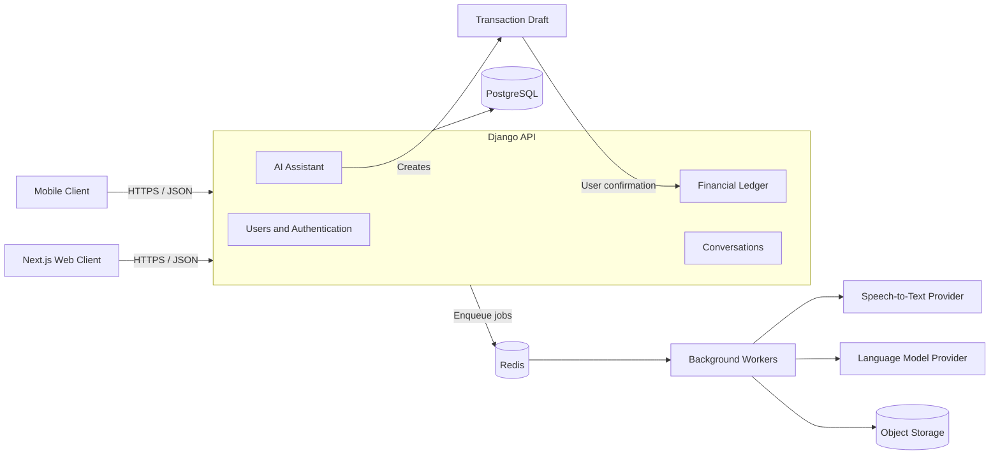

# Financify

Financify is a personal finance platform for recording income, expenses, and
transfers through structured forms, natural-language conversations, and voice
messages.

The repository is organized as a monorepo. The backend is a modular Django
application, the web client will use Next.js, and shared TypeScript packages can
be consumed by future clients.

## Architecture



The API starts as a modular monolith. HTTP processes and background workers may
run independently while sharing the same Django codebase and PostgreSQL database.
Domain boundaries are kept explicit so a component can be extracted later when
independent scaling or operation is justified.

AI-generated data is always treated as untrusted input. Text and audio produce a
transaction draft, and only explicit user confirmation can create a financial
transaction.

## Current implementation

- Django REST Framework API under `apps/api`.
- PostgreSQL development service managed by Docker Compose.
- Custom UUID-based user model with email authentication.
- Case-insensitive email normalization and database constraint.
- Password validation using Django's configured validators.
- Customized Django Admin integration.
- User registration serializer and HTTP endpoint.
- Model, serializer, and API integration test suites.

## Technology stack

| Area | Technology |
| --- | --- |
| Backend | Python, Django, Django REST Framework |
| Database | PostgreSQL |
| Python dependency management | uv |
| Local infrastructure | Docker Compose |
| Web client | React, TypeScript, Next.js |
| Background processing | Celery and Redis |
| File storage | S3-compatible object storage |
| API contract | REST and OpenAPI |

## Repository structure

```text
financify/
├── apps/
│   ├── api/                 # Django API
│   ├── web/                 # Next.js web client
│   └── mobile/              # Mobile client
├── packages/                # Shared client packages
├── infra/
│   └── compose.yaml         # Local PostgreSQL service
├── docs/
│   ├── architecture.md
│   ├── learning-roadmap.md
│   └── adr/                 # Architecture decision records
└── scripts/
```

Some application directories are reserved for later implementation and may be
empty.

## Requirements

- Python 3.15
- [uv](https://docs.astral.sh/uv/)
- Docker with Docker Compose

## Local setup

Create the local environment file:

```bash
cp apps/api/.env.example apps/api/.env
```

Start PostgreSQL:

```bash
docker compose -f infra/compose.yaml up -d --wait
```

Install dependencies and prepare the database:

```bash
cd apps/api
uv sync
uv run python manage.py migrate
```

Start the API:

```bash
uv run python manage.py runserver
```

The development server is available at `http://127.0.0.1:8000/`.

## Environment variables

The committed `.env.example` documents the local configuration contract:

| Variable | Purpose |
| --- | --- |
| `DEBUG` | Enables or disables Django debug mode |
| `DJANGO_SECRET_KEY` | Signs security-sensitive Django values |
| `DJANGO_ALLOWED_HOSTS` | Comma-separated list of accepted hosts |
| `DATABASE_URL` | PostgreSQL connection URL |

The local `.env` file is intentionally ignored by Git. Production secrets must
be supplied by the deployment platform or a dedicated secret manager.

## API

### Register a user

```http
POST /api/v1/users/register/
Content-Type: application/json
```

Example request:

```json
{
  "email": "user@example.com",
  "password": "StrongPassword!123",
  "password_confirmation": "StrongPassword!123",
  "first_name": "Joao",
  "last_name": "Tessarolo",
  "currency": "BRL",
  "timezone": "America/Sao_Paulo"
}
```

Successful requests return `201 Created`. Password fields are write-only and are
never included in the response.

## Tests

Run the complete backend suite:

```bash
cd apps/api
uv run python manage.py test
```

Run only the users application tests:

```bash
uv run python manage.py test users
```

The users suite is split by responsibility:

```text
users/tests/
├── test_models.py
├── test_serializers.py
└── test_views.py
```

Model and serializer tests use Django's transactional `TestCase`. HTTP endpoint
tests use Django REST Framework's `APITestCase` and `APIClient`.

## Development checks

Before committing backend changes, run:

```bash
cd apps/api
uv run python manage.py check
uv run python manage.py makemigrations --check --dry-run
uv run python manage.py test
```

Models and their migrations must be committed together. Environment files,
virtual environments, database volumes, caches, and uploaded files must not be
committed.

## Architecture documentation

- [System architecture](docs/architecture.md)
- [Learning and implementation roadmap](docs/learning-roadmap.md)
- [Architecture decision records](docs/adr)
