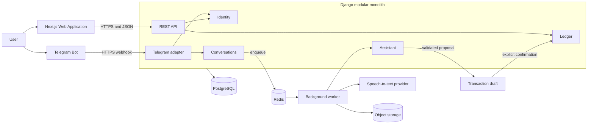

# System architecture

## Purpose

Financify is a personal finance product with two primary interfaces:

- a Telegram bot for conversational entry through text and voice messages;
- a Next.js web application for account setup, review, reporting, and financial management.

The backend starts as a modular Django monolith. Domain boundaries remain explicit without introducing distributed-system complexity before it is needed.

## System view



The Telegram bot and the web application are delivery mechanisms. Neither owns financial rules. Both reach the ledger through application services in the Django backend.

## Backend modules

### Identity

Owns authentication, the user profile, currency and timezone preferences, and external identities. A Telegram identity is linked to a Financify user by the numeric Telegram user ID, never by the mutable Telegram username.

Account linking uses a short-lived, single-use token created by the authenticated web application and consumed through a Telegram `/start` deep link.

### Ledger

Owns accounts, transactions, entries, transfers, posting, and financial invariants. It is independent of Telegram and AI providers.

A posting service validates the complete transaction atomically, including:

- every account and transaction belongs to the same user;
- every entry uses the transaction currency;
- debit and credit totals are equal;
- amounts are positive;
- a transaction cannot be posted twice.

### Conversations

Owns conversations, inbound and outbound messages, voice attachments, processing state, and the association between a message and a transaction draft. Channel and message format are modeled separately:

- channel examples: `TELEGRAM` and, if introduced later, `WEB`;
- message type examples: `TEXT`, `VOICE`, and `SYSTEM`.

### Assistant

Owns transcription orchestration, intent recognition, and structured extraction. Provider SDKs remain behind application interfaces. AI output is untrusted and can only create or update a transaction draft.

### Telegram adapter

Owns Telegram-specific protocol concerns:

- webhook validation and update parsing;
- update idempotency using `update_id`;
- commands and callback queries;
- inline confirmation buttons;
- downloading voice messages by `file_id`;
- translating application responses into Telegram messages.

It does not create ledger entries directly. Production uses an HTTPS webhook; local development may use long polling.

## Conversational transaction flow

```text
Telegram text or voice message
  -> validate and persist the Telegram update
  -> persist the conversation message
  -> enqueue slow or external processing
  -> transcribe voice when applicable
  -> extract and validate structured data
  -> create a TransactionDraft
  -> ask the user to confirm, edit, or cancel
  -> explicit confirmation
  -> call the Ledger posting service
  -> atomically create and post Transaction and Entries
  -> send the result to Telegram
```

The webhook acknowledges accepted updates quickly. Transcription, model calls, and retries run outside the webhook request.

## Source, channel, and message type

These concepts must not be conflated:

| Concept | Meaning | Examples |
| --- | --- | --- |
| Transaction source | How the financial record was produced | `MANUAL`, `ASSISTANT`, `IMPORT`, `API` |
| Conversation channel | Where the interaction occurred | `TELEGRAM`, potentially `WEB` |
| Message type | The format of a conversation message | `TEXT`, `VOICE`, `SYSTEM` |

A voice message sent to Telegram and interpreted by the assistant therefore has an `ASSISTANT` transaction source, a `TELEGRAM` channel, and a `VOICE` message type.

## Security and reliability rules

1. Telegram is initially supported only in private chats.
2. Bot tokens and webhook secrets are provided through environment variables.
3. Webhook requests must validate Telegram's secret-token header.
4. Telegram `update_id` and confirmation callbacks are processed idempotently.
5. Account-linking tokens are random, short-lived, single-use, and stored safely.
6. Every domain query and command is scoped to the linked Financify user.
7. AI output is validated before it becomes a draft and again before posting.
8. Voice files are temporary artifacts governed by an explicit retention policy.
9. Logs must not contain bot tokens, linking tokens, or raw sensitive payloads.
10. External requests have timeouts, bounded retries, and observable failures.

## Data and infrastructure

- PostgreSQL is the source of truth.
- Redis and background workers handle asynchronous processing.
- S3-compatible object storage holds voice files only when persistence is needed.
- Money uses decimal values and explicit ISO 4217 currency codes.
- Timestamps are stored as timezone-aware UTC values and displayed using the user's timezone.

## Evolution rules

- The web application remains the management and reporting interface.
- A web chat is a future product decision, not part of the Telegram feature.
- Telegram-specific code depends on application services, not ledger models directly.
- A module becomes a separate service only when independent scaling, deployment, reliability, or ownership provides measurable value.
- Rust is introduced only when profiling identifies a local CPU-bound bottleneck that it can materially improve.
